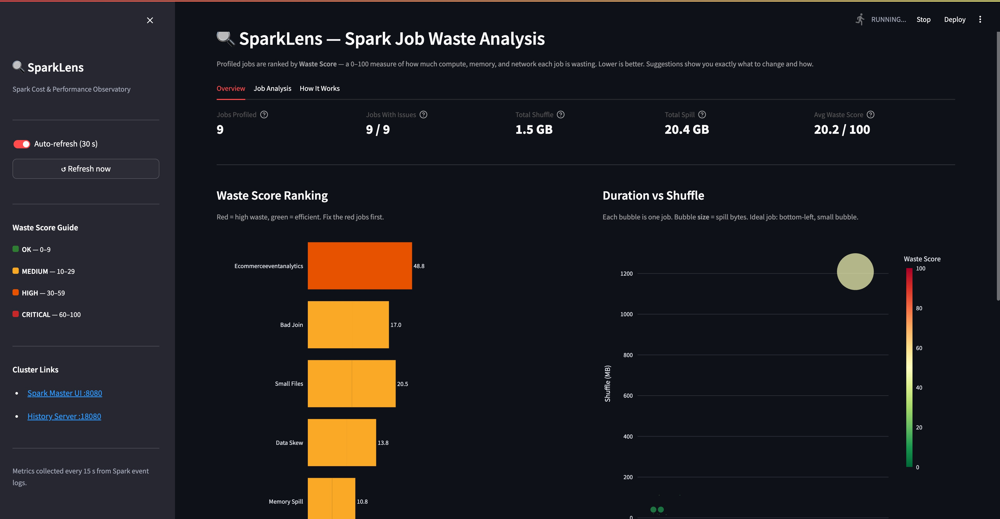
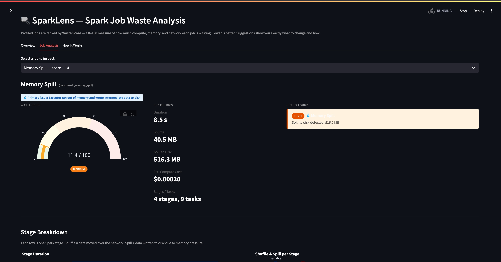
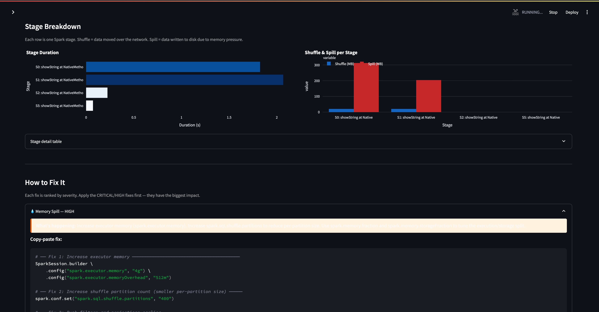

# SparkLens

> Profile Spark jobs for shuffle, spill, and skew — then fix them.

SparkLens runs four synthetic PySpark benchmark jobs that expose common
inefficiencies (data skew, memory spill, small files, bad joins). A collector
parses the Spark event logs in real time, scores each job by waste, and
surfaces actionable fix suggestions on a live Streamlit dashboard.

Everything runs locally with one command.

---

## Screenshots

<!-- Dashboard overview -->


<!-- Waste score chart -->


<!-- Job detail with suggestions -->


---

## Prerequisites

| Tool | Version |
|------|---------|
| Docker | 24+ |
| Docker Compose | v2 (`docker compose`) |

No Python, Java, or Spark installation required on the host.

---

## Quick Start

```bash
# 1. Clone the repo
git clone https://github.com/murthykaja/SparkLens.git
cd SparkLens

# 2. Build and start all services
docker compose up --build

# 3. Open the dashboard
open http://localhost:8501
```

The benchmark jobs take about **3–5 minutes** to finish.
The dashboard auto-refreshes — just leave it open.

---

## Services

| Service | URL | Description |
|---------|-----|-------------|
| SparkLens Dashboard | http://localhost:8501 | Job rankings, waste scores, suggestions |
| Spark Master UI | http://localhost:8080 | Live cluster view |
| Spark History Server | http://localhost:18080 | Completed job stage details |
| PostgreSQL | localhost:5432 | `sparklens` DB (user: `sparklens`, pw: `sparklens123`) |

---

## How It Works

```
Benchmark Jobs  ──spark-submit──>  Spark Cluster
                                       │
                               event log (JSON)
                                       │
                                       ▼
                              Collector (Python)
                          parse ─ analyze ─ score
                                       │
                                  PostgreSQL
                                       │
                                       ▼
                          Streamlit Dashboard :8501
```

1. **Benchmark Runner** submits four PySpark jobs against the local Spark cluster.
2. **Spark** writes a JSON event log per job (shuffle bytes, spill bytes, task timings…).
3. **Collector** polls the log directory every 15 s, parses each completed log, computes a waste score and cost estimate, runs five rule-based checks, and inserts everything into PostgreSQL.
4. **Dashboard** queries PostgreSQL and renders the ranked jobs table, waste bar chart, per-stage breakdown, and color-coded fix suggestions.

---

## Benchmark Jobs

| Job | Waste Pattern | Key Config |
|-----|--------------|-----------|
| `job_skew.py` | 90% of rows on one key → task imbalance | AQE off, broadcast disabled |
| `job_spill.py` | Large sort under 512 MB executor budget → disk spill | `spark.executor.memory=512m` |
| `job_small_files.py` | 300 tiny partitions → scheduling overhead | `shuffle.partitions=300` |
| `job_bad_join.py` | Sort-merge join with tiny dim tables | `autoBroadcastJoinThreshold=-1` |

---

## Project Structure

```
SparkLens/
├── docker-compose.yml          # All 7 services
├── architecture.md             # System diagram, data flow, DB schema
│
├── spark/
│   ├── Dockerfile
│   ├── entrypoint.sh           # Waits for cluster, submits jobs
│   ├── conf/spark-defaults.conf
│   └── jobs/
│       ├── job_skew.py
│       ├── job_spill.py
│       ├── job_small_files.py
│       └── job_bad_join.py
│
├── collector/
│   ├── Dockerfile
│   ├── main.py                 # Polling loop
│   ├── log_parser.py           # Spark JSON event log parser
│   ├── analyzer.py             # Rule engine + waste score + cost
│   └── db.py                   # SQLAlchemy persistence
│
├── dashboard/
│   ├── Dockerfile
│   └── app.py                  # Streamlit UI
│
└── postgres/
    └── init.sql                # Schema: jobs, stages, suggestions, metrics
```

---

## Analysing Your Own Spark Jobs

SparkLens only needs the **Spark event log file** — it never connects to your cluster.

### Step 1 — Enable event logging in your Spark app

```python
spark = SparkSession.builder \
    .config("spark.eventLog.enabled", "true") \
    .config("spark.eventLog.dir", "file:///tmp/spark-events") \
    .getOrCreate()
```

Or add to `spark-defaults.conf`:
```
spark.eventLog.enabled   true
spark.eventLog.dir       file:///tmp/spark-events
```

### Step 2 — Copy the completed log into SparkLens

```bash
# The log file is named by app ID, e.g. app-20240601-120000-0001
docker cp /tmp/spark-events/app-20240601-120000-0001 \
    sparklens-collector:/spark-events/
```

The collector picks it up within **15 seconds** automatically.

### Step 3 — (Optional) Run only the analysis stack

No Spark cluster needed — just bring up the three analysis services:

```bash
docker compose up postgres collector dashboard
```

Then copy event logs in as in Step 2.

### Step 4 — Find your job in the dashboard

Open **Job Analysis** tab → select your job from the dropdown.
The display name is derived from `spark.app.name` in your Spark config.

> **Tip:** To watch a live log directory, bind-mount it as the `spark-events` volume:
> ```yaml
> volumes:
>   spark-events:
>     driver: local
>     driver_opts: { type: none, o: bind, device: /your/log/path }
> ```

---

## Tech Stack

| Layer | Technology |
|-------|-----------|
| Compute | Apache Spark 3.5.1 (custom ubuntu:22.04 image) |
| Jobs | PySpark 3.5 |
| Storage | PostgreSQL 15 |
| Collection | Python 3.11, SQLAlchemy 2 |
| Dashboard | Streamlit, Plotly |
| Infra | Docker Compose v3.8 |

---

## Stopping

```bash
docker compose down          # stop containers, keep volumes
docker compose down -v       # stop + wipe all data
```
