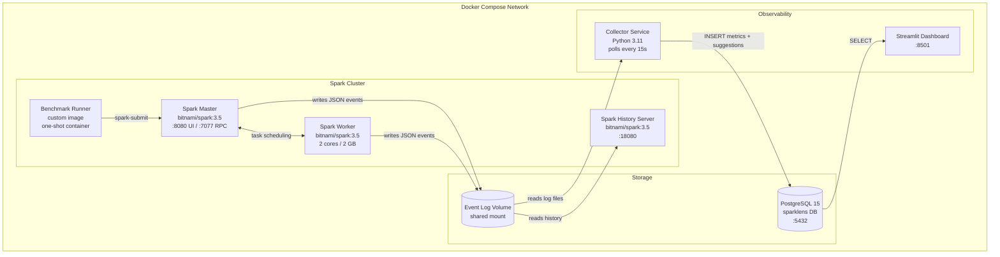
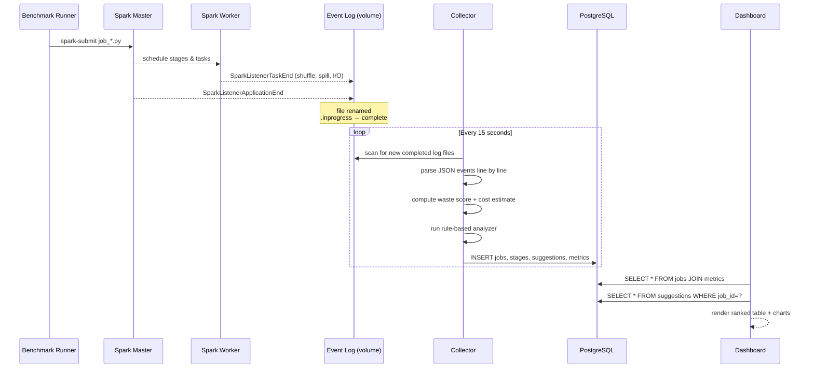
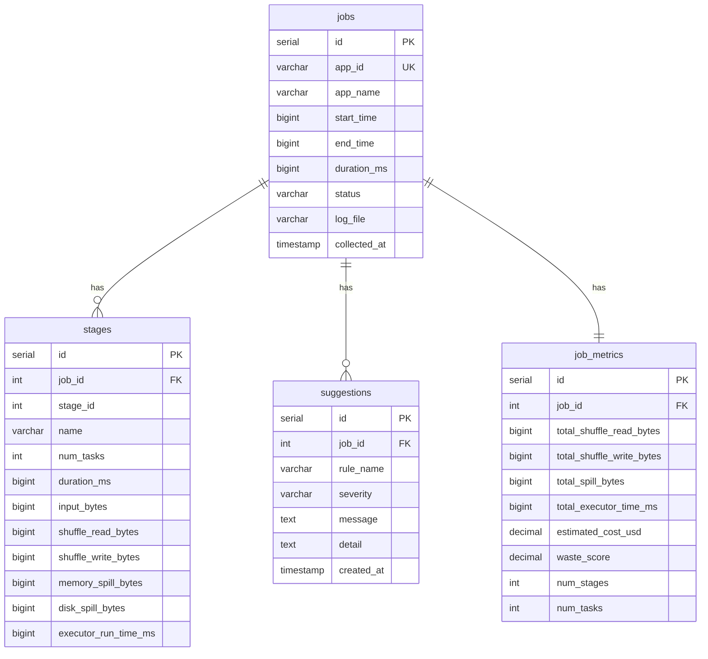

# SparkLens — Architecture

## System Architecture



---

## Data Flow



---

## Component Breakdown

### 1. Spark Cluster (`bitnami/spark:3.5`)

| Role | Port | Purpose |
|------|------|---------|
| Master | 8080, 7077 | Web UI + cluster coordination |
| Worker | — | Task execution (2 cores, 2 GB) |
| History Server | 18080 | Browse completed job event logs |

**Key Spark config** (`spark-defaults.conf`):
```
spark.eventLog.enabled           true
spark.eventLog.dir               file:///opt/bitnami/spark/logs/events
spark.history.fs.logDirectory    file:///opt/bitnami/spark/logs/events
spark.sql.adaptive.enabled       false   # disabled for benchmarks to expose raw waste
```

---

### 2. Benchmark Jobs (PySpark)

Four synthetic jobs, each designed to expose a specific class of waste:

| Job | Waste Type | Technique |
|-----|-----------|-----------|
| `job_skew.py` | Data skew | 90% rows on one key, sort-merge join |
| `job_spill.py` | Memory spill | 512 MB executor limit + large sort |
| `job_small_files.py` | Too many partitions | 300 tiny partitions, 300 shuffle tasks |
| `job_bad_join.py` | Wrong join strategy | Broadcast threshold disabled, small dim table forced into sort-merge join |

---

### 3. Collector (Python 3.11)

```
collector/
├── main.py          # polling loop — watches event log dir every 15s
├── log_parser.py    # JSON event log parser → JobLog + StageInfo dataclasses
├── analyzer.py      # rule engine → Suggestion list + waste_score + cost estimate
└── db.py            # SQLAlchemy — persists to PostgreSQL
```

**Parsing pipeline:**
```
Event Log File (JSON lines)
  └── SparkListenerApplicationStart   → app_id, app_name, start_time
  └── SparkListenerStageCompleted     → stage duration, task count
  └── SparkListenerTaskEnd            → shuffle, spill, I/O, executor time
  └── SparkListenerApplicationEnd     → end_time → duration_ms
```

**Waste score formula (0–100):**
```
waste_score = min(shuffle_GB × 5, 30)     # shuffle component
            + min(spill_GB × 15, 30)      # spill component (heavily weighted)
            + min(duration_min × 2, 20)   # duration component
            + min((skew_ratio − 1) × 5, 20) # skew component
```

**Cost estimate:**
```
cost_usd = (total_executor_time_ms / 3_600_000) × num_executors × $0.12/vCPU-hr
```

**Rules engine:**

| Rule | Trigger | Severity |
|------|---------|---------|
| `HIGH_SHUFFLE` | shuffle > 1 GB | HIGH |
| `MEMORY_SPILL` | spill > 0 bytes | HIGH / CRITICAL |
| `DATA_SKEW` | max task / median task > 5× | HIGH |
| `SMALL_FILES` | avg input per task < 1 MB | MEDIUM |
| `LOW_PARALLELISM` | CPU utilization < 30% in a stage | MEDIUM |

---

### 4. PostgreSQL Schema



---

### 5. Streamlit Dashboard

```
Page layout
├── Sidebar:  refresh rate, filters, about
└── Main
    ├── KPI row:  Jobs Profiled · Total Shuffle · Total Spill · Est. Cost · Avg Waste
    ├── Waste Score Chart:  horizontal bar chart (red→green), one bar per job
    ├── Jobs Table:  sortable, with inline waste score bars
    └── Job Detail (expander per job)
        ├── Stage Breakdown table
        ├── Shuffle + Spill bar chart (per stage)
        └── Suggestions list  (CRITICAL / HIGH / MEDIUM / LOW badges)
```

---

## Technology Stack

| Layer | Technology | Version | Why |
|-------|-----------|---------|-----|
| Compute | Apache Spark | 3.5 | Industry-standard distributed compute |
| Job language | PySpark | 3.5 | Python-native Spark API |
| Event logs | Spark JSON event log | built-in | Per-task granularity, no agent needed |
| Storage | PostgreSQL | 15 | Relational — easy joins across jobs/stages/suggestions |
| ORM / queries | SQLAlchemy | 2.x | Safe parameterized queries |
| Dashboard | Streamlit | latest | Fast Python-native dashboard |
| Charts | Plotly | latest | Interactive visualizations |
| Containerization | Docker Compose | v3.8 | One-command local setup |
| Base images | bitnami/spark:3.5, python:3.11-slim | — | Production-grade, minimal attack surface |

---

## Port Map

| Service | Port | URL |
|---------|------|-----|
| Spark Master UI | 8080 | http://localhost:8080 |
| Spark History Server | 18080 | http://localhost:18080 |
| PostgreSQL | 5432 | postgresql://localhost:5432/sparklens |
| SparkLens Dashboard | 8501 | http://localhost:8501 |
